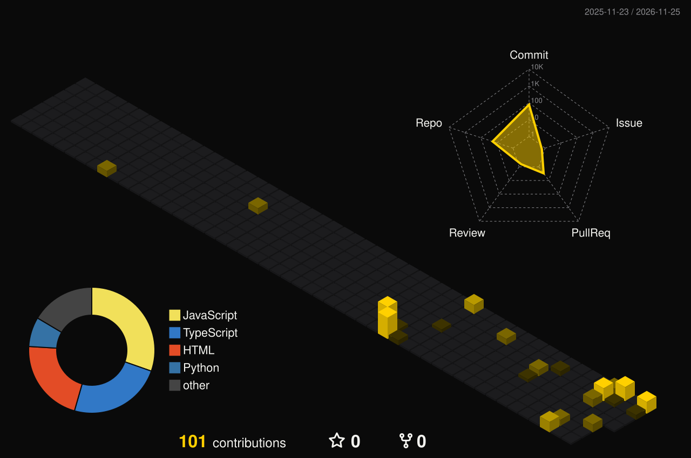

<!--
  fadeddarts · GitHub Profile README
  Dense editorial sheet + ba-00001 widgets (3D cityscape + snake)
-->

<p align="center">
  
</p>

<p align="center">
  <a href="https://fadeddarts.github.io/portfolio/"></a>
  <a href="https://www.linkedin.com/in/harpuneet-390-singh/"></a>
  <a href="mailto:harpuneet.singh@torontomu.ca"></a>
  
</p>

<p align="center">
  
</p>

---

## `SHEET 01` — INDEX & SCOPE

CS co-op student at **Toronto Metropolitan University** (CGPA **3.91**, Dean's List). I build full-stack systems and interaction tools — backlog engines, camera-verified mobile prototypes, WebGL visualizers, retrieval/eval harnesses, and campus curriculum pipelines.

```
FOCUS       full-stack systems · automation · computer vision · interactive graphics
BUILDING    SprintForge · CV Object-Lock Alarm · RGB Decomposer · TMU Curriculum Pipeline
SHIPPED     FORGE · ATLAS · AEGIS · portfolio demos (Aether, Kinetic Type, Synapse…)
STACK       TypeScript · Python · Swift · Next.js · Prisma · WebGL · FastAPI
ASK ME      debugging data → API → UI · making demos defendable in interviews
```

<p align="center">
  
  
</p>

---

## `SHEET 02` — SELECTED SYSTEMS & WORK

### Systems

| ID | SYSTEM | ARCHITECTURE & SCOPE | STACK | LINK |
|:--:|:--|:--|:--|:--|
| 01 | **FORGE** | Concurrent DAG workflow engine — retries, dead-letter isolation, Prometheus metrics | Python · FastAPI · Docker | [repo](https://github.com/fadeddarts/forge) |
| 02 | **ATLAS** | Lexical retrieval + eval harness — BM25 / TF-IDF, cited answers, fixed question suite | Python · FastAPI · NumPy · scikit-learn | [repo](https://github.com/fadeddarts/atlas) |
| 03 | **AEGIS** | Mutation fuzzing harness for lab C/Python parsers with crash triage | Python · C · Docker | [repo](https://github.com/fadeddarts/aegis) |
| 04 | **SprintForge** | Full-stack agile backlog / sprint management — issues, cycles, status flows | Next.js · TypeScript · Prisma · SQLite | [github](https://github.com/fadeddarts) |
| 05 | **CV Object-Lock Alarm** | Native iOS alarm — dismiss requires live camera object verification | Swift · Vision · AVAudioPlayer | [github](https://github.com/fadeddarts) |
| 06 | **TMU Curriculum Pipeline** | Schedule scraper + JS bundler for course-planning data used by staff and students | Python · BeautifulSoup · Node.js | [github](https://github.com/fadeddarts) |

### Creative lab (live demos)

| DEMO | WHAT IT IS | LIVE |
|:--|:--|:--|
| **Portfolio** | Swiss / editorial personal site — systems proof + motion experiments | [open](https://fadeddarts.github.io/portfolio/) |
| **Aether** | Real-time WebGL fluid field + generative audio | [open](https://fadeddarts.github.io/aether/) |
| **Kinetic Type** | 3D type that shatters, scatters, and reforms | [open](https://fadeddarts.github.io/kinetic-type/) |
| **Synapse** | Generative neural mesh | [open](https://fadeddarts.github.io/synapse/) |
| **Chronos** | Spatial timepiece | [open](https://fadeddarts.github.io/chronos/) |
| **Currents** | Interactive flow distortion | [open](https://fadeddarts.github.io/currents/) |
| **Minimalist Raycaster** | Pure JS first-person engine | [open](https://fadeddarts.github.io/minimalist-raycaster/) |
| **Blender Art Lab** | Procedural sculpture playground | [open](https://fadeddarts.github.io/blender-art-lab/) |

<details>
<summary><strong>Algorithmic / competitive &amp; systems labs</strong></summary>

<br/>

| ID | SYSTEM | SCOPE | STACK |
|:--:|:--|:--|:--|
| A1 | Bitwise / number-theory drills | Python optimization — bit tricks, modular arithmetic, tight I/O | Python |
| A2 | Systems lab parsers | Mutation-aware crash triage; C/Python parser harnesses | C · Python · Docker |
| A3 | Retrieval eval harnesses | Lexical ranking (BM25 / TF-IDF) with cited answers | Python · NumPy · scikit-learn |
| A4 | SQL / CPS-510 coursework | Relational modeling & query practice | SQL |

</details>

---

## `SHEET 03` — TECHNICAL MATRIX

```
LANGUAGES            Python · TypeScript · JavaScript · Swift · SQL · C/C++ · HTML/CSS
FRONTEND & MOBILE    Next.js · React · WebGL/Canvas · Three.js · GSAP · Swift · Vision
BACKEND & DATA       FastAPI · Prisma · SQLite · PostgreSQL · Node.js · REST · NumPy
SYSTEMS & TOOLING    Git · Docker · BeautifulSoup · PowerShell · Agile · fuzzing / eval harnesses
```

<p align="center">
  
</p>

---

## `SHEET 04` — FIELD LOG & CREDENTIALS

| PERIOD | ROLE | ORG / CONTEXT | NOTES |
|:--|:--|:--|:--|
| May 2026 → present | **Student Developer** | TMU First-Year Engineering Office | Maintain course-planning web app; trace bad results through source data → processing → UI |
| Jan 2026 → May 2026 | **Accounting & Data Automation Assistant** | HNM Logistics | PowerShell automations for Excel→PDF reporting with validation and success-gated routing |
| Sep 2024 → May 2028 | **B.Sc. Computer Science (Co-op)** | Toronto Metropolitan University · Class of 2028 | CGPA 3.91 · Dean's List (multi-term) |

**Coursework:** Probability & Statistics · Data Structures · Software Engineering · *in progress:* AI · Database Systems

---

## `SHEET 05` — CONTRIBUTION INSTRUMENTS

<p align="center">
  
</p>

<p align="center">
  
</p>

---

<p align="center">
  <a href="https://fadeddarts.github.io/portfolio/">PORTFOLIO</a>
  ·
  <a href="https://github.com/fadeddarts?tab=repositories">REPOSITORIES</a>
  ·
  <a href="https://www.linkedin.com/in/harpuneet-390-singh/">LINKEDIN</a>
  ·
  <a href="mailto:harpuneet.singh@torontomu.ca">EMAIL</a>
</p>

<p align="center">
  <sub>INK #0A0A0A · PAPER #F4F4F0 · SIGNAL #FFD000 — systems first, telemetry second.</sub>
</p>
